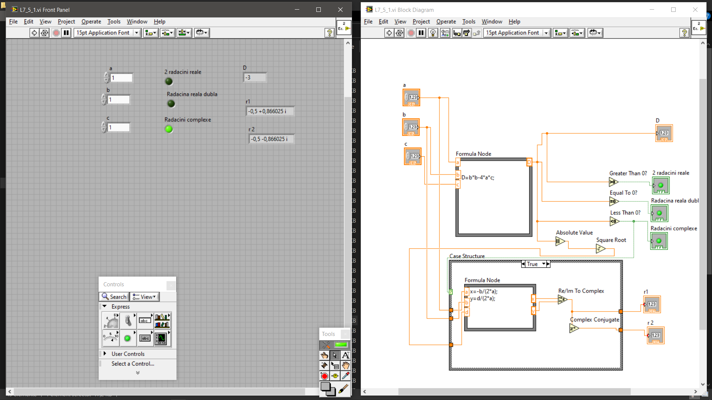
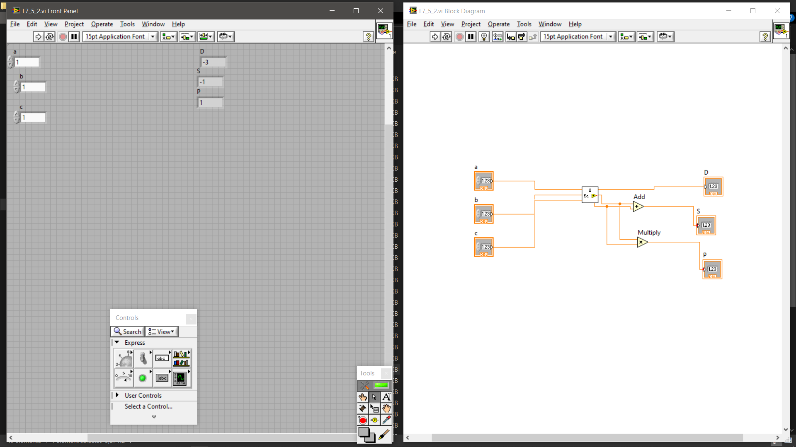
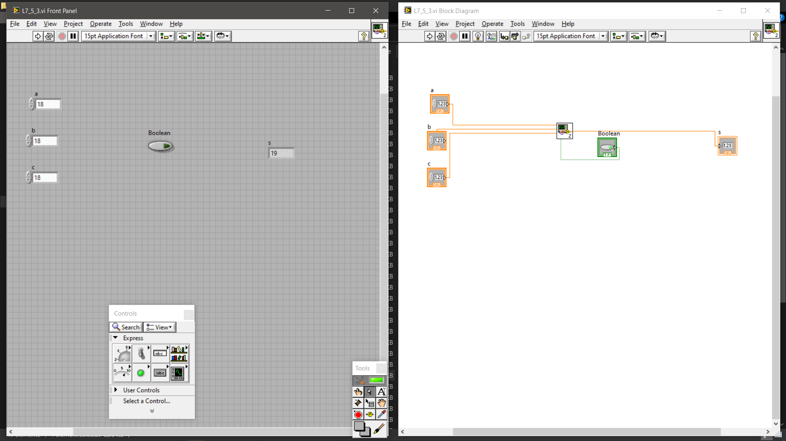
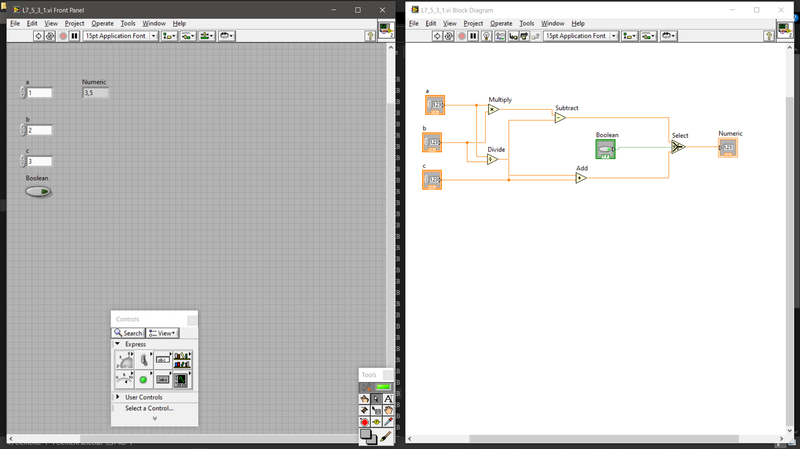
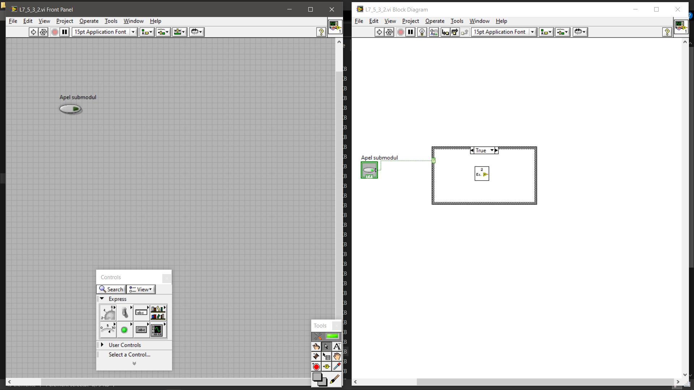
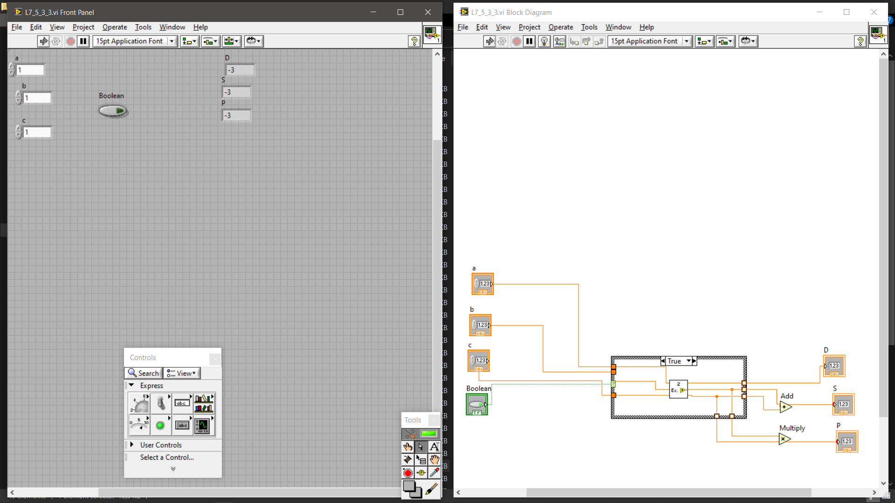

# Aplicații matematice și logică condițională în LabVIEW

---

# 🇷🇴 Română

## 1. Despre proiect

Acest proiect conține șase aplicații dezvoltate în **NI LabVIEW**, care demonstrează implementarea unor algoritmi matematici și utilizarea structurilor fundamentale de programare grafică.

Proiectul urmărește aplicarea conceptelor de prelucrare a datelor numerice, evaluare a expresiilor matematice, logică booleană, structuri condiționale și modularizare prin subVI-uri.

Aplicațiile sunt organizate gradual, de la rezolvarea ecuațiilor de gradul al doilea până la implementarea unor operații matematice controlate prin condiții logice.

Fiecare aplicație include fișierul `.vi` și o captură de ecran care prezintă interfața Front Panel și diagrama Block Diagram.

## 2. Aplicații implementate

### 2.1. Rezolvarea ecuației de gradul al doilea — `L7_5_1.vi`

**Obiectiv**

Implementarea unui algoritm pentru determinarea naturii rădăcinilor unei ecuații de gradul al doilea:

$$
ax^2+bx+c=0
$$

**Intrări**
- `a` – coeficientul termenului de gradul al doilea.
- `b` – coeficientul termenului de gradul întâi.
- `c` – termenul liber.

**Procesare și algoritm**

1. Calculează discriminantul:
   $$
   Delta=b^2-4ac
   $$
2. Evaluează valoarea discriminantului.
3. Utilizează comparații numerice pentru identificarea cazului corespunzător:
   - Δ mai mare decât zero: două rădăcini reale distincte.
   - Δ egal cu zero: două rădăcini reale egale.
   - Δ mai mic decât zero: două rădăcini complexe conjugate.
4. Pentru cazul rădăcinilor complexe, utilizează valoarea absolută, radicalul și conversia componentelor reale și imaginare în numere complexe.
5. Utilizează o structură `Case` pentru calcularea soluțiilor complexe.

**Ieșiri**
- Discriminantul `D`.
- Indicatori pentru clasificarea rădăcinilor.
- Rădăcinile `r1` și `r2`.

**Concepte LabVIEW demonstrate**
- Formula Node.
- Operații matematice.
- Comparații numerice.
- Structura Case.
- Tipuri de date complexe.
- Conversia componentelor reale și imaginare.

**Exemplu de execuție**

Pentru `a = 1`, `b = 1`, `c = 1`:

$$
Delta=1^2-4\cdot1\cdot1=-3
$$

Rezultatul este reprezentat de două rădăcini complexe conjugate:

$$
x_{1,2}=-0.5\pm0.866025i
$$



---

### 2.2. Calculul discriminantului, sumei și produsului rădăcinilor — `L7_5_2.vi`

**Obiectiv**

Implementarea unui algoritm pentru calcularea discriminantului, sumei și produsului rădăcinilor unei ecuații de gradul al doilea.

**Intrări**
- `a` – coeficientul principal.
- `b` – coeficientul termenului de gradul întâi.
- `c` – termenul liber.

**Procesare și algoritm**

Aplicația utilizează un subVI pentru calculul discriminantului, apoi prelucrează rezultatele prin operații aritmetice.

Discriminantul:

$$
Delta=b^2-4ac
$$

Relațiile lui Viète:

$$
S=x_1+x_2=-\frac{b}{a}
$$

$$
P=x_1\cdot x_2=\frac{c}{a}
$$

**Ieșiri**
- `D` – discriminantul.
- `S` – suma rădăcinilor.
- `P` – produsul rădăcinilor.

**Concepte LabVIEW demonstrate**
- Apelarea unui subVI.
- Transferul datelor între VI-uri.
- Operații aritmetice.
- Utilizarea funcțiilor Add și Multiply.
- Modularizarea programului.

**Exemplu de execuție**

Pentru `a = 1`, `b = 1`, `c = 1`:

$$
D=-3,\qquad S=-1,\qquad P=1
$$



---

### 2.3. Apelarea unui subVI cu intrări numerice și condiție booleană — `L7_5_3.vi`

**Obiectiv**

Demonstrarea integrării unui subVI într-o aplicație LabVIEW, folosind intrări numerice și un control boolean.

**Intrări**
- `a`, `b`, `c` – trei valori numerice.
- `Boolean` – control logic pentru transmiterea condiției către subVI.

**Procesare și algoritm**

1. Preia valorile numerice introduse în Front Panel.
2. Transmite datele și condiția booleană către subVI.
3. Utilizează rezultatul furnizat de subVI în aplicația principală.

**Ieșiri**
- `s` – rezultat numeric furnizat de subVI.

**Concepte LabVIEW demonstrate**
- Apelarea subVI-urilor.
- Terminale de intrare și ieșire.
- Transfer de date între VI-uri.
- Controale numerice.
- Logică booleană.
- Modularizarea aplicațiilor.

**Exemplu de execuție**

În captura inclusă sunt prezentate valorile:

- `a = 18`
- `b = 18`
- `c = 18`
- Rezultat afișat: `s = 19`

Captura ilustrează conectarea intrărilor și a controlului boolean la subVI.



---

### 2.4. Selectarea rezultatelor prin funcția Select — `L7_5_3_1.vi`

**Obiectiv**

Implementarea unor operații aritmetice paralele și selectarea rezultatului final în funcție de o condiție booleană.

**Intrări**
- `a` – prima valoare numerică.
- `b` – a doua valoare numerică.
- `c` – a treia valoare numerică.
- `Boolean` – condiția de selecție.

**Procesare și algoritm**

Diagrama Block Diagram conține două ramuri de calcul:

Prima ramură:

$$
R_1=(a\cdot b)-c
$$

A doua ramură:

$$
R_2=\frac{a}{b}+c
$$

Funcția `Select` alege unul dintre cele două rezultate în funcție de valoarea intrării booleene.

**Ieșiri**
- `Numeric` – rezultatul selectat.

**Concepte LabVIEW demonstrate**
- Operații Multiply, Subtract, Divide și Add.
- Execuția ramificată a operațiilor.
- Funcția Select.
- Logică booleană.
- Selectarea condiționată a datelor.

**Exemplu de execuție**

Pentru `a = 1`, `b = 2`, `c = 3`:

$$
R_1=(1\cdot2)-3=-1
$$

$$
R_2=\frac{1}{2}+3=3.5
$$

Cu selecția corespunzătoare celei de-a doua ramuri, rezultatul afișat este:

$$
Numeric=3.5
$$



---

### 2.5. Controlul apelării unui subVI prin structura Case — `L7_5_3_2.vi`

**Obiectiv**

Demonstrarea controlului execuției unui subVI prin intermediul unei structuri condiționale `Case`.

**Intrări**
- `Apel submodul` – control boolean care determină ramura executată.

**Procesare și algoritm**

1. Valoarea booleană este conectată la selectorul structurii `Case`.
2. Structura evaluează condiția logică.
3. În cazul `True`, este executat subVI-ul conectat în interiorul structurii.
4. În cazul `False`, este selectată ramura alternativă.

**Ieșiri**
- Execuția sau omiterea apelării subVI-ului, în funcție de condiția booleană.

**Concepte LabVIEW demonstrate**
- Structura Case.
- Controlul fluxului de execuție.
- Condiții booleene.
- Apelarea condiționată a subVI-urilor.
- Programare modulară.

**Exemplu de execuție**

| Intrare booleană | Comportament |
|---|---|
| `True` | Se execută subVI-ul |
| `False` | Nu se execută subVI-ul din cazul True |



---

### 2.6. Calculul condiționat prin subVI și structura Case — `L7_5_3_3.vi`

**Obiectiv**

Integrarea unui subVI într-o structură condițională pentru prelucrarea coeficienților unei ecuații și obținerea unor rezultate numerice.

**Intrări**
- `a` – primul coeficient.
- `b` – al doilea coeficient.
- `c` – al treilea coeficient.
- `Boolean` – condiția de execuție a structurii Case.

**Procesare și algoritm**

1. Preia coeficienții numerici.
2. Utilizează condiția booleană pentru selectarea cazului din structura `Case`.
3. În cazul `True`, transmite datele către subVI.
4. Prelucrează rezultatele prin operații aritmetice suplimentare.
5. Utilizează funcțiile `Add` și `Multiply` pentru obținerea rezultatelor finale.

**Ieșiri**
- `D` – rezultat numeric asociat discriminantului.
- `S` – rezultat numeric asociat sumei.
- `P` – rezultat numeric asociat produsului.

**Concepte LabVIEW demonstrate**
- Structura Case.
- SubVI Integration.
- Operații aritmetice.
- Transferul datelor prin tunelurile structurii Case.
- Programare modulară.
- Control condiționat al execuției.

**Exemplu de execuție**

În captura inclusă sunt prezentate valorile:

- `a = 1`
- `b = 1`
- `c = 1`
- `Boolean = True`

Valorile afișate în Front Panel sunt:

- `D = -3`
- `S = -3`
- `P = -3`



---

## 3. Tehnologii și competențe tehnice

**Tehnologii**
- NI LabVIEW.
- G Programming Language.

**Concepte și competențe demonstrate**
- Graphical Programming.
- Mathematical Algorithms.
- Numeric Data Processing.
- Boolean Logic.
- Conditional Structures (Case Structure).
- Formula Node.
- Select Function.
- SubVI Integration.
- Modular Programming.
- Dataflow Programming.

## 4. Structura proiectului

```text
Aplicatii-matematice-si-logica-conditionala-LabVIEW/
│
├── README.md
│
├── aplicatii/
│   ├── L7_5_1.vi
│   ├── L7_5_2.vi
│   ├── L7_5_3.vi
│   ├── L7_5_3_1.vi
│   ├── L7_5_3_2.vi
│   └── L7_5_3_3.vi
│
└── capturi/
    ├── L7-1.png
    ├── L7-2.png
    ├── L7-3.png
    ├── L7-3-1.png
    ├── L7-3-2.png
    └── L7-3-3.png
```

## 5. Cerințe și instalare

- NI LabVIEW instalat.
- O versiune LabVIEW compatibilă cu fișierele proiectului.

**Pași de rulare:**

1. Clonează repository-ul sau descarcă proiectul.
2. Deschide directorul `aplicatii/`.
3. Deschide fișierul `.vi` dorit în NI LabVIEW.
4. Introdu valorile necesare în Front Panel.
5. Rulează aplicația folosind butonul Run.

## 6. Scopul proiectului

Proiectul demonstrează aplicarea practică a conceptelor fundamentale de programare grafică în LabVIEW, prin implementarea unor algoritmi matematici, utilizarea structurilor de control și dezvoltarea unor aplicații modulare.

---

# 🇬🇧 English

## 1. Project Overview

This project contains six applications developed using **NI LabVIEW**, demonstrating mathematical algorithms and fundamental graphical programming concepts.

The project focuses on numeric data processing, mathematical expressions, Boolean logic, conditional structures, and modular programming through subVI integration.

The applications progress from quadratic equation solving to conditional mathematical operations and modular application design.

Each application is provided as a `.vi` file, accompanied by screenshots showing its Front Panel and Block Diagram.

## 2. Implemented Applications

### 2.1. Quadratic Equation Solver — `L7_5_1.vi`

**Objective**

Implement an algorithm to determine the nature of the roots of a quadratic equation:

$$
ax^2+bx+c=0
$$

**Inputs**
- `a` – quadratic coefficient.
- `b` – linear coefficient.
- `c` – constant term.

**Processing and Algorithm**

1. Calculates the discriminant:

   $$
   Delta=b^2-4ac
   $$

2. Evaluates the discriminant value.
3. Determines the nature of the roots:
   - Δ greater than zero: two distinct real roots.
   - Δ equal to zero: two equal real roots.
   - Δ less than zero: two complex conjugate roots.
4. For complex roots, calculates the real and imaginary components using absolute value, square root, and complex number conversion.
5. Uses a `Case Structure` to calculate the complex solutions.

**Outputs**
- Discriminant `D`.
- Boolean indicators for root classification.
- Roots `r1` and `r2`.

**LabVIEW Concepts**
- Formula Node.
- Mathematical operations.
- Numeric comparison functions.
- Case Structure.
- Complex numeric data types.
- Real and imaginary component conversion.

**Execution Example**

For `a = 1`, `b = 1`, `c = 1`:

$$
Delta=1-4=-3
$$

The equation has two complex conjugate roots:

$$
x_{1,2}=-0.5\pm0.866025i
$$


---

### 2.2. Discriminant, Sum and Product of Roots — `L7_5_2.vi`

**Objective**

Calculate the discriminant, sum, and product of the roots of a quadratic equation.

**Inputs**
- `a` – quadratic coefficient.
- `b` – linear coefficient.
- `c` – constant term.

**Processing and Algorithm**

The application uses a subVI to calculate the discriminant and performs additional arithmetic operations.

Discriminant:

$$
Delta=b^2-4ac
$$

Vieta's formulas:

$$
S=x_1+x_2=-\frac{b}{a}
$$

$$
P=x_1x_2=\frac{c}{a}
$$

**Outputs**
- `D` – discriminant.
- `S` – sum of roots.
- `P` – product of roots.

**LabVIEW Concepts**
- SubVI integration.
- Data transfer between VIs.
- Arithmetic operations.
- Add and Multiply functions.
- Modular programming.

**Execution Example**

For `a = 1`, `b = 1`, `c = 1`:

$$
D=-3,\quad S=-1,\quad P=1
$$


---

### 2.3. SubVI Integration with Numeric Inputs and Boolean Control — `L7_5_3.vi`

**Objective**

Demonstrate the integration of a subVI using numeric inputs and a Boolean control.

**Inputs**
- `a`, `b`, `c` – numeric values.
- `Boolean` – logical control connected to the subVI.

**Processing and Algorithm**

1. Receives numeric values from the Front Panel.
2. Transfers the input data and Boolean condition to the subVI.
3. Uses the result returned by the subVI in the main application.

**Outputs**
- `s` – numeric result returned by the subVI.

**LabVIEW Concepts**
- SubVI integration.
- Input and output terminals.
- Data transfer between VIs.
- Numeric controls.
- Boolean logic.
- Modular application design.

**Execution Example**

The included screenshot displays:

- `a = 18`
- `b = 18`
- `c = 18`
- Displayed output: `s = 19`


---

### 2.4. Conditional Result Selection Using the Select Function — `L7_5_3_1.vi`

**Objective**

Implement parallel arithmetic operations and select the final result based on a Boolean condition.

**Inputs**
- `a` – first numeric input.
- `b` – second numeric input.
- `c` – third numeric input.
- `Boolean` – selection condition.

**Processing and Algorithm**

The Block Diagram contains two arithmetic branches.

First branch:

$$
R_1=(a\cdot b)-c
$$

Second branch:

$$
R_2=\frac{a}{b}+c
$$

The `Select` function chooses one of the two results based on the Boolean input.

**Outputs**
- `Numeric` – selected result.

**LabVIEW Concepts**
- Multiply, Subtract, Divide and Add functions.
- Parallel arithmetic operations.
- Select function.
- Boolean logic.
- Conditional data selection.

**Execution Example**

For `a = 1`, `b = 2`, `c = 3`:

$$
R_1=(1\cdot2)-3=-1
$$

$$
R_2=\frac{1}{2}+3=3.5
$$

When the second branch is selected, the displayed result is:

$$
Numeric=3.5
$$


---

### 2.5. Conditional SubVI Execution Using a Case Structure — `L7_5_3_2.vi`

**Objective**

Demonstrate how a `Case Structure` controls subVI execution based on a Boolean condition.

**Inputs**
- `Call Submodule` – Boolean control used to determine the executed case.

**Processing and Algorithm**

1. The Boolean value is connected to the Case Structure selector.
2. The structure evaluates the logical condition.
3. When the condition is `True`, the subVI inside that case is executed.
4. When the condition is `False`, the alternative case is selected.

**Outputs**
- Conditional execution or omission of the subVI call.

**LabVIEW Concepts**
- Case Structure.
- Execution flow control.
- Boolean conditions.
- Conditional subVI execution.
- Modular programming.

**Execution Example**

| Boolean input | Behavior |
|---|---|
| `True` | Executes the subVI |
| `False` | Does not execute the subVI in the True case |


---

### 2.6. Conditional Mathematical Processing Using a SubVI — `L7_5_3_3.vi`

**Objective**

Integrate a subVI into a conditional structure to process equation coefficients and obtain numeric results.

**Inputs**
- `a` – first coefficient.
- `b` – second coefficient.
- `c` – third coefficient.
- `Boolean` – condition controlling the Case Structure.

**Processing and Algorithm**

1. Receives the numeric coefficients.
2. Uses the Boolean condition to select the corresponding Case.
3. Executes the subVI in the `True` case.
4. Processes the returned values through additional arithmetic operations.
5. Uses `Add` and `Multiply` functions to obtain the final outputs.

**Outputs**
- `D` – numeric output associated with the discriminant.
- `S` – numeric output associated with the sum.
- `P` – numeric output associated with the product.

**LabVIEW Concepts**
- Case Structure.
- SubVI integration.
- Arithmetic operations.
- Data transfer through Case Structure tunnels.
- Modular programming.
- Conditional execution control.

**Execution Example**

The included screenshot displays:

- `a = 1`
- `b = 1`
- `c = 1`
- `Boolean = True`

Displayed Front Panel values:

- `D = -3`
- `S = -3`
- `P = -3`


---

## 3. Technologies and Technical Skills

**Technologies**
- NI LabVIEW.
- G Programming Language.

**Technical Concepts**
- Graphical Programming.
- Mathematical Algorithms.
- Numeric Data Processing.
- Boolean Logic.
- Conditional Structures (Case Structure).
- Formula Node.
- Select Function.
- SubVI Integration.
- Modular Programming.
- Dataflow Programming.

## 4. Project Structure

```text
Aplicatii-matematice-si-logica-conditionala-LabVIEW/
│
├── README.md
│
├── aplicatii/
│   ├── L7_5_1.vi
│   ├── L7_5_2.vi
│   ├── L7_5_3.vi
│   ├── L7_5_3_1.vi
│   ├── L7_5_3_2.vi
│   └── L7_5_3_3.vi
│
└── capturi/
    ├── L7-1.png
    ├── L7-2.png
    ├── L7-3.png
    ├── L7-3-1.png
    ├── L7-3-2.png
    └── L7-3-3.png
```

## 5. Requirements and Execution

**Requirements**
- NI LabVIEW installation.
- A LabVIEW version compatible with the provided VI files.

**Execution Steps**

1. Clone or download the repository.
2. Open the `aplicatii/` directory.
3. Open the desired `.vi` file in NI LabVIEW.
4. Enter the required values in the Front Panel.
5. Run the application using the Run button.

**Note:** Applications using subVIs also require their corresponding VI files.

## 6. Project Purpose

This project demonstrates the practical application of fundamental graphical programming concepts in LabVIEW through mathematical algorithms, control structures, Boolean logic, and modular application development.

---

## 👤 Autor / Author

**IonutD**
